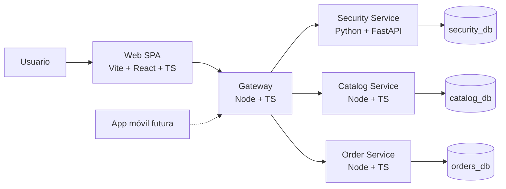

# PerfumesPAYDAY

Tienda online de perfumes al por menor y al por mayor, con catálogo de marcas reconocidas y una línea de réplicas AAA. Este repositorio corresponde a un **simulador académico**: no procesa pagos reales, no factura electrónicamente y no comercializa productos reales durante la beta.

> **Estado:** fase de planeación. No hay código funcional de la aplicación todavía.
>
> **Propósito de este README:** ser la fuente principal de contexto para el equipo, el profesor y cualquier asistente de IA que colabore en el proyecto.

---

## 1. Resumen del proyecto

PerfumesPAYDAY será una plataforma web funcional que permita:

- Explorar un catálogo de perfumes por marca, género, familia olfativa y presentación.
- Consultar precios de referencia en pesos colombianos (COP).
- Registrarse, iniciar sesión y gestionar un carrito.
- Simular un checkout sin pasarela de pagos real.
- Consultar el historial de pedidos.
- Administrar catálogo y pedidos desde un panel protegido.
- Mostrar una sección de ventas al por mayor como **"Próximamente"**.

La arquitectura debe permitir que, más adelante, una aplicación móvil consuma la misma API sin reescribir la lógica de negocio.

---

## 2. Contexto académico y reglas del proyecto

| Regla | Detalle |
|---|---|
| Tipo de proyecto | Simulador académico, no producto comercial real |
| Equipo | 4 personas desarrollando |
| Duración | 3 semanas |
| Sesiones con el profesor | 6 sesiones (2 por semana) |
| Metodología | Scrum/Kanban (Scrumban) con tablero en GitHub Projects |
| Rol del profesor | Scrum Master y stakeholder; entrega retroalimentación cada 2 días |
| Rol del líder | Líder técnico y desarrollador senior; arquitectura, revisiones y desbloqueos |
| Arquitectura obligatoria | Microservicios |
| Despliegue | Docker; Kubernetes se evaluará más adelante |
| Prueba de seguridad | El profesor realizará hacking ético básico sobre la versión desplegada |
| Entregable final | Beta funcional, desplegada y documentada |

### Restricciones importantes

- **Microservicios es un requisito académico**, no una decisión opcional. No proponer un monolito.
- La beta debe ser funcional y navegable, no solo maquetas.
- El proyecto debe poder desplegarse con Docker.
- La documentación se actualiza junto con cada cambio de comportamiento.
- No se implementan pagos reales, facturación DIAN, envíos reales ni app móvil en esta fase.
- No se debe crear código de aplicación sin autorización explícita del líder del proyecto.

---

## 3. Alcance

### 3.1 Incluido en la beta

- Catálogo con datos simulados (aproximadamente 25 a 30 productos).
- Variantes por presentación (30 ml, 50 ml, 100 ml) y concentración.
- Búsqueda y filtros por marca, género y familia olfativa.
- Detalle de producto con precio, stock simulado y selector de variante.
- Registro, inicio de sesión y cierre de sesión.
- Roles: `customer`, `admin` y `wholesale` (este último reservado).
- Carrito de compras.
- Checkout simulado que crea un pedido.
- Historial de pedidos del usuario.
- Panel administrativo básico: CRUD de productos y consulta de pedidos.
- Página de mayoristas con mensaje **"Próximamente"**.
- Diseño responsive.
- Documentación por componente.
- Despliegue en un proveedor por definir.

### 3.2 Fuera de alcance por ahora

- Pasarelas de pago reales (Wompi, Mercado Pago, PayU, Stripe).
- Facturación electrónica DIAN.
- Integración con transportadoras o cálculo real de envíos.
- App móvil nativa.
- Flujo completo B2B (aprobación, cupos, cotizaciones, crédito).
- Inventario multibodega.
- Reseñas, wishlist y programa de fidelización.
- Analítica avanzada, marketing y SEO.
- Asesoría legal o gestión marcaria.

### 3.3 B2B

La sección B2B queda como **placeholder visible**:

- Ruta `/mayoristas`.
- Página informativa con "Próximamente".
- Sin formulario funcional, sin aprobación y sin precios mayoristas activos.
- El modelo de datos debe prever `customer_type`, `price_list_id` y `approval_status` para activarlo después.

No se prioriza hasta que el líder del proyecto lo solicite.

---

## 4. Arquitectura

### 4.1 Diagrama lógico



### 4.2 Servicios

| Servicio | Tecnología | Responsabilidad | Exposición |
|---|---|---|---|
| `web` | Vite + React + TypeScript + Tailwind | Interfaz retail y panel admin | Pública |
| `gateway` | Node.js + TypeScript | Punto único de entrada, CORS, headers, rate limit general y enrutamiento | Pública |
| `security-service` | Python + FastAPI | Registro, login, roles, JWT, refresh, rate limit de autenticación y auditoría | Interna |
| `catalog-service` | Node.js + TypeScript | Marcas, productos, variantes, precios, stock, búsqueda y filtros | Interna |
| `order-service` | Node.js + TypeScript | Carrito validado, checkout simulado, pedidos e historial | Interna |
| `postgres` | PostgreSQL | Persistencia, una base de datos por servicio | Privada |

### 4.3 Principios de arquitectura

- **API-first:** toda la lógica de negocio se consume por API; la web y el futuro móvil usan los mismos contratos.
- **Contratos versionados:** prefijo `/api/v1` y especificación OpenAPI por servicio.
- **Base de datos por servicio:** `security_db`, `catalog_db` y `orders_db`; sin joins entre bases.
- **Sin tablas compartidas:** cada servicio es dueño de sus datos.
- **Snapshots en pedidos:** `order-service` guarda nombre, variante y precio del momento de la compra.
- **Solo el gateway es público:** los servicios internos y PostgreSQL quedan en la red privada.
- **Docker desde el inicio:** cada servicio con su Dockerfile y `docker-compose` para desarrollo.
- **Kubernetes después:** manifiestos al final si el tiempo alcanza; no se monta un clúster para la beta.
- **Simplicidad:** sin Kafka, service mesh, event sourcing ni API gateway complejo.

### 4.4 Comunicación

- REST/JSON sobre HTTP.
- Validación de JWT con clave pública (RS256/JWKS) en gateway y servicios Node.
- `security-service` es el único emisor de tokens.
- Checkout con clave de idempotencia para evitar pedidos duplicados.
- Para la beta no se usa broker de mensajes; si se requiere, se evalúa después.

---

## 5. Stack tecnológico

| Capa | Tecnología | Estado |
|---|---|---|
| Frontend | Vite + React + TypeScript + Tailwind CSS | Confirmado |
| Ruteo frontend | React Router | Propuesto |
| Estado y datos frontend | TanStack Query + Zustand/Context | Propuesto |
| Backend | Node.js + TypeScript | Confirmado |
| Framework HTTP backend | Fastify o NestJS | Pendiente de ADR |
| Seguridad | Python + FastAPI | Confirmado |
| Base de datos | PostgreSQL | Confirmado |
| ORM/migraciones | Prisma o Drizzle | Pendiente de ADR |
| Contenedores | Docker + Docker Compose | Confirmado |
| Orquestación | Kubernetes | Fase posterior |
| Despliegue | Azure Container Apps, Railway, Render o VPS | Pendiente |
| Frontend hosting | Vercel u otro proveedor estático | Pendiente |
| Pruebas | Vitest, Playwright y pytest | Propuesto |
| Documentación | Markdown + Mermaid + ADRs + OpenAPI | Confirmado |

### 5.1 Justificación breve

- **Vite + React:** SPA simple, sin la complejidad de Next.js; el equipo ya decidió no usar Next.js en esta fase.
- **Tailwind:** velocidad de maquetación y consistencia visual.
- **Node + TypeScript:** mismo lenguaje en la mayor parte del backend y contratos compartidos.
- **FastAPI:** servicio de seguridad aislado, validación con Pydantic y ecosistema Python.
- **PostgreSQL:** integridad relacional para catálogo, precios, stock y pedidos.
- **Docker:** requisito de despliegue y preparación para Kubernetes.

---

## 6. Estructura del repositorio

### 6.1 Estado actual

```text
PerfumesPAYDAY/
├── Backend/
│   └── docs/
├── Frontend/
│   └── docs/
├── Databases/
│   └── docs/
├── security/
│   └── docs/
├── movil/
│   └── docs/
└── README.MD
```

### 6.2 Estructura objetivo (propuesta)

```text
PerfumesPAYDAY/
├── Backend/
│   ├── services/
│   │   ├── gateway/
│   │   ├── catalog/
│   │   └── orders/
│   └── docs/
│       └── README.md
├── Frontend/
│   ├── src/
│   └── docs/
│       └── README.md
├── Databases/
│   ├── init/
│   ├── seeds/
│   └── docs/
│       └── README.md
├── security/
│   ├── security-service/
│   └── docs/
│       └── README.md
├── movil/
│   └── docs/
│       └── README.md
├── docs/
│   ├── README.md
│   ├── architecture.md
│   ├── adr/
│   ├── api/
│   ├── scrum.md
│   ├── security.md
│   └── beta-criteria.md
└── README.MD
```

La estructura base (carpetas y README por componente) ya está creada. Los servicios, el código y la documentación global se agregarán en las siguientes fases.

---

## 7. Documentación

### 7.1 Documentación por componente

| Componente | Ruta | Estado |
|---|---|---|
| Frontend | [`Frontend/docs/README.md`](Frontend/docs/README.md) | Creado |
| Backend | [`Backend/docs/README.md`](Backend/docs/README.md) | Creado |
| Bases de datos | [`Databases/docs/README.md`](Databases/docs/README.md) | Creado |
| Seguridad | [`security/docs/README.md`](security/docs/README.md) | Creado |
| Móvil | [`movil/docs/README.md`](movil/docs/README.md) | Creado |

> Los README de cada componente ya existen con su stack tecnológico. Se ampliarán con propósito, ejecución, endpoints y decisiones a medida que avance el proyecto.

### 7.2 Documentación global

| Documento | Contenido |
|---|---|
| `docs/architecture.md` | C4, decisiones y diagramas |
| `docs/adr/` | Registros de decisiones de arquitectura |
| `docs/api/` | Contratos OpenAPI por servicio |
| `docs/scrum.md` | Tablero, sprints, retroalimentación y métricas |
| `docs/security.md` | Amenazas, controles y resultados del hacking ético |
| `docs/beta-criteria.md` | Criterios de aceptación de la beta |

### 7.3 Reglas de documentación

- Cada componente tiene su README con: propósito, stack, cómo ejecutarlo, endpoints, variables de entorno, decisiones y estado.
- Todo cambio de comportamiento actualiza el README del componente en el mismo pull request.
- Las decisiones importantes se registran como ADR.
- Los contratos OpenAPI son la fuente de verdad de la API.
- La documentación se escribe en español; el código y los identificadores, en inglés.

---

## 8. Seguridad

### 8.1 Línea base

- Contraseñas con Argon2 o bcrypt.
- JWT de acceso de corta duración y refresh token.
- Roles y permisos verificados en el servidor, nunca solo en la interfaz.
- Prevención de IDOR: un cliente solo puede ver sus propios pedidos.
- Validación de entrada con Zod/Pydantic.
- Consultas parametrizadas u ORM; sin SQL concatenado.
- CORS con allowlist.
- Rate limit en login, registro y checkout.
- Headers de seguridad y HTTPS.
- Secretos fuera del repositorio; solo `.env.example` versionado.
- PostgreSQL y servicios internos sin exposición pública.
- Contenedores non-root y dependencias auditadas.
- Logs sin datos personales sensibles.
- Auditoría de acciones administrativas.

### 8.2 Prueba de hacking ético

El profesor atacará la versión desplegada con técnicas básicas. El equipo debe preparar y documentar:

- Pruebas de autenticación y autorización.
- Prueba de IDOR en pedidos y rutas admin.
- Prueba de inyección SQL y XSS.
- Prueba de CORS y rate limit.
- Revisión de secretos expuestos y servicios abiertos.
- Escaneo básico con OWASP ZAP.
- Resultados y correcciones en `docs/security.md`.

---

## 9. Flujos clave

### 9.1 Registro e inicio de sesión

1. El usuario envía credenciales al gateway.
2. El gateway reenvía a `security-service`.
3. FastAPI valida y emite tokens.
4. El frontend usa el token de acceso y renueva sesión con el refresh token.
5. Los servicios validan el JWT con la clave pública.

### 9.2 Catálogo

1. El frontend consulta `/api/v1/products` con filtros.
2. El gateway enruta a `catalog-service`.
3. El servicio devuelve productos, variantes, precios y stock.
4. El frontend renderiza listado y detalle.

### 9.3 Checkout simulado

1. El carrito vive en el cliente durante la beta.
2. Al confirmar, el frontend envía los ítems a `order-service`.
3. `order-service` revalida precio y stock contra `catalog-service`.
4. Crea el pedido con snapshot de producto y precio.
5. El pago se marca como simulado; no se llama a ninguna pasarela.
6. El usuario ve la confirmación y el pedido en su historial.

### 9.4 Administración

1. El administrador inicia sesión con rol `admin`.
2. Accede a `/admin`, protegido en frontend y backend.
3. Gestiona productos y consulta pedidos.
4. Toda acción administrativa queda auditada.

---

## 10. Datos simulados

- 25 a 30 productos de demostración.
- 5 a 8 marcas reconocidas y una línea AAA.
- Variantes de 30 ml, 50 ml y 100 ml.
- Precios en COP acordes al mercado, sin valor comercial real.
- Stock simulado.
- Imágenes de marcador de posición o recursos libres.
- Datos de usuarios y pedidos ficticios.
- Script de seed idempotente.

No se deben usar imágenes, logotipos ni assets con derechos de autor sin autorización. El catálogo es una simulación académica.

---

## 11. Scrum y cronograma

### 11.1 Roles

| Rol | Responsable |
|---|---|
| Scrum Master / stakeholder | Profesor |
| Líder técnico / senior | Líder del proyecto |
| Equipo de desarrollo | 4 personas |
| Product Owner provisional | Líder del proyecto, hasta definir otra persona |

### 11.2 Tablero Kanban

Columnas propuestas:

`Backlog` → `Ready` → `In Progress` → `Review` → `Done`

- WIP máximo: 2 tareas por persona en `In Progress`.
- Swimlanes por dominio: Frontend, Seguridad, Catálogo, Pedidos, Infraestructura.
- Cada tarjeta debe tener criterios de aceptación y enlace al PR.
- La retroalimentación del profesor se convierte en nuevas tarjetas del backlog.

### 11.3 DoR y DoD

**Definition of Ready:**

- Historia con objetivo claro.
- Criterios de aceptación verificables.
- Contrato de API definido si aplica.
- Diseño o referencia visual si aplica.
- Dependencias identificadas.

**Definition of Done:**

- Código revisado por otra persona.
- Pruebas mínimas del flujo.
- Documentación del componente actualizada.
- Desplegado en staging.
- Sin secretos ni credenciales en el repositorio.
- Criterios de aceptación cumplidos.

### 11.4 Sprints

| Semana | Objetivo | Entregable |
|---|---|---|
| Semana 1 | Fundaciones y walking skeleton | Repo, Docker, CI, auth, catálogo en lectura, SPA base y despliegue inicial |
| Semana 2 | Retail funcional | Catálogo completo, carrito, checkout simulado, historial, admin y seed |
| Semana 3 | Endurecimiento y cierre | Seguridad, pruebas, B2B placeholder, documentación, despliegue final y demo |

Cada sesión con el profesor se usa para demo, retroalimentación y refinamiento del backlog.

---

## 12. Criterios de beta

La beta se considera lista cuando:

- [ ] Está desplegada en una URL pública con HTTPS.
- [ ] El catálogo tiene datos simulados y se puede filtrar y buscar.
- [ ] El detalle de producto muestra variantes, precio y stock.
- [ ] Un usuario puede registrarse, iniciar y cerrar sesión.
- [ ] El carrito funciona y persiste durante la sesión.
- [ ] El checkout simulado crea un pedido y muestra confirmación.
- [ ] El usuario puede consultar su historial de pedidos.
- [ ] El panel admin está protegido y permite CRUD de productos y consulta de pedidos.
- [ ] La página de mayoristas muestra "Próximamente".
- [ ] La interfaz es responsive y maneja estados de carga y error.
- [ ] Los controles de seguridad de la línea base están aplicados.
- [ ] `docker-compose` levanta el entorno local.
- [ ] La documentación y los enlaces del README están actualizados.
- [ ] Existe un guion de demo para la presentación final.

---

## 13. Decisiones abiertas

| Decisión | Estado | Notas |
|---|---|---|
| Proveedor de hosting del backend | Abierta | Azure Container Apps, Railway, Render o VPS |
| Hosting del frontend | Abierta | Vercel u otro proveedor estático |
| Dominio propio | Abierta | Afecta cookies y CORS |
| Framework HTTP de Node | Abierta | Fastify o NestJS |
| ORM/migraciones | Abierta | Prisma o Drizzle |
| Almacenamiento de tokens | Abierta | Depende del hosting y del dominio |
| Kubernetes real vs. manifiestos | Abierta | Puede bastar con manifiestos y `kind`/`minikube` |
| Activación del B2B | Abierta | Solo cuando el líder lo solicite |
| Identidad visual y assets | Abierta | Sin recursos con derechos |

---

## 14. Convenciones de trabajo

- **Ramas:** trunk-based con ramas cortas (`feat/`, `fix/`, `docs/`, `chore/`).
- **Commits:** Conventional Commits.
- **Pull requests:** revisión obligatoria de otra persona y CI en verde.
- **API:** prefijo `/api/v1`, contratos OpenAPI y errores consistentes.
- **Fechas:** ISO 8601 en UTC.
- **Moneda:** COP; precios retail con IVA incluido como supuesto del simulador.
- **IDs:** UUID.
- **Secretos:** variables de entorno; nunca en el repositorio.
- **Calidad:** pruebas del flujo crítico antes de la demo.
- **Alcance:** si el tiempo aprieta, se recorta primero B2B, admin avanzado, filtros y animaciones. Nunca seguridad ni checkout.

---

## 15. Glosario

| Término | Significado |
|---|---|
| SKU | Unidad de inventario vendible; en perfumes suele ser la variante |
| Variante | Presentación y concentración de un producto (ej. 100 ml EDP) |
| Retail | Venta al detal |
| Wholesale / B2B | Venta al por mayor |
| AAA | Línea de réplicas o inspiraciones de perfumes, claramente separada del catálogo original |
| TLC | Tratado de Libre Comercio; relevante para costos de importación, fuera del alcance de la beta |
| COP | Peso colombiano |
| DIAN | Autoridad tributaria colombiana; facturación electrónica fuera de alcance |
| JWT | Token firmado para autenticación |
| RBAC | Control de acceso basado en roles |
| IDOR | Vulnerabilidad por acceso a recursos de otro usuario |
| Seed | Datos iniciales de demostración |
| Walking skeleton | Flujo mínimo funcional desplegado de punta a punta |
| ADR | Architecture Decision Record |
| DoR / DoD | Definition of Ready / Definition of Done |

---

## 16. Instrucciones para asistentes de IA

Si eres una IA que colabora en este repositorio, sigue estas reglas:

1. **No generes código de aplicación sin autorización explícita** del líder del proyecto. La fase actual es de planeación y documentación.
2. **No propongas un monolito.** Los microservicios son un requisito académico.
3. **Respeta el stack:** Vite + React + TypeScript + Tailwind; Node.js + TypeScript; Python + FastAPI; PostgreSQL; Docker.
4. **No agregues** Kafka, service mesh, Next.js, pasarelas de pago reales, DIAN, app móvil ni Kubernetes real sin autorización.
5. **No inventes** marcas, precios, credenciales, endpoints ni decisiones de arquitectura. Si falta información, pregunta.
6. **Prioriza la beta de 3 semanas.** Propón lo mínimo que cumpla los criterios de aceptación.
7. **Documenta** cada cambio en el README del componente y, si es una decisión, en un ADR.
8. **Seguridad primero:** valida autorización en el servidor, no expongas servicios internos y no incluyas secretos.
9. **Contratos antes que implementación:** si propones un endpoint, define método, ruta, entrada, salida y errores.
10. **Indica el impacto:** al proponer un cambio, di qué archivos se afectan y qué documentación debe actualizarse.

---

## 17. Enlaces de referencia

- Tablero Kanban: pendiente de enlace público.
- Repositorio: pendiente de URL definitiva.
- Documentación global: pendiente de creación.
- Entorno desplegado: pendiente.

---

**Última actualización:** 2026-11-02  
**Versión del documento:** 0.1 — planeación
