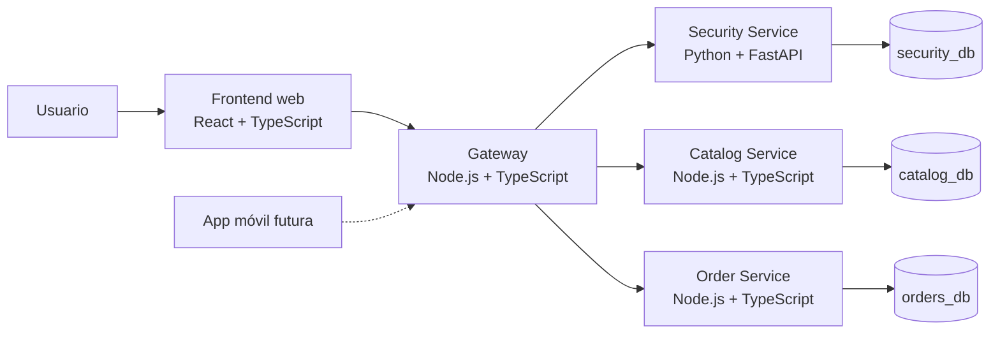

# PerfumesPAYDAY

Tienda online de perfumes creada como proyecto académico. La experiencia está inspirada en **MercadoLibre**: una persona puede registrarse, iniciar sesión, armar su propio carrito, registrar una dirección de envío y simular una compra.

> **Importante:** es un simulador académico. No cobra dinero real, no emite facturas electrónicas y no envía productos reales.

**Estado actual:** fase de planeación y estructura base. La documentación general P0 ya está redactada; todavía no existe código funcional de la aplicación.

---

## Tabla de contenido

1. [¿Qué es este proyecto?](#1-qué-es-este-proyecto)
2. [Equipo](#2-equipo)
3. [Estructura del repositorio](#3-estructura-del-repositorio)
4. [Tecnologías utilizadas](#4-tecnologías-utilizadas)
5. [¿Cómo funcionará la aplicación?](#5-cómo-funcionará-la-aplicación)
6. [Flujos principales](#6-flujos-principales)
7. [Seguridad](#7-seguridad)
8. [Reglas y alcance del proyecto](#8-reglas-y-alcance-del-proyecto)
9. [Cómo colaborar](#9-cómo-colaborar)
10. [Documentación](#10-documentación)
11. [Cronograma](#11-cronograma)
12. [Glosario para principiantes](#12-glosario-para-principiantes)
13. [Instrucciones para asistentes de IA](#13-instrucciones-para-asistentes-de-ia)
14. [Enlaces de referencia](#14-enlaces-de-referencia)

---

## 1. ¿Qué es este proyecto?

PerfumesPAYDAY será una página web para explorar y comprar perfumes. El proyecto busca parecerse a una tienda real, pero con fines educativos.

La aplicación permitirá:

- Ver un catálogo de perfumes con marcas, presentaciones y precios de referencia en pesos colombianos (COP).
- Buscar y filtrar productos por marca, género y familia olfativa.
- Registrarse e iniciar sesión.
- Tener un carrito de compras asociado a cada usuario.
- Guardar una o más direcciones de envío.
- Simular el checkout y generar un pedido.
- Consultar el historial de pedidos.
- Administrar el catálogo desde un panel protegido para administradores.
- Mostrar la sección de ventas al por mayor como **"Próximamente"**.

Más adelante, una aplicación móvil podrá consumir la misma API sin reescribir la lógica del negocio.

### ¿Qué significa que sea un monorepo?

Un **monorepo** es un solo repositorio de Git que contiene varios proyectos relacionados. En este caso conviven el frontend, los servicios del backend, la base de datos, la seguridad y la futura aplicación móvil.

La ventaja es que todo el equipo trabaja en un mismo lugar y los cambios se revisan juntos. La regla principal es mantener cada parte separada y con una responsabilidad clara.

### ¿Qué significa que use microservicios?

Un **microservicio** es un pequeño programa con una responsabilidad concreta. En lugar de tener un solo programa gigante, el proyecto se divide en varios servicios especializados:

- Uno se encarga de la seguridad y las sesiones.
- Otro del catálogo de perfumes.
- Otro de los pedidos.
- Un **gateway** recibe todas las peticiones y las dirige al servicio correcto.

Es parecido a un centro comercial: el usuario entra por una puerta principal (gateway) y cada local (servicio) atiende lo que le corresponde.

---

## 2. Equipo

| Nombre completo | Carrera | Rol | Código de estudiante |
|---|---|---|---|
| Jessid Agudelo | T.D.S. | Backend Developer | 2478460 |
| Pendiente | Pendiente | Pendiente | Pendiente |
| Pendiente | Pendiente | Pendiente | Pendiente |
| Pendiente | Pendiente | Pendiente | Pendiente |

> Reemplazar los datos pendientes cuando el resto del equipo los confirme.

---

## 3. Estructura del repositorio

La estructura está organizada por áreas y por servicio. Cada carpeta tiene una única responsabilidad.

```text
PerfumesPAYDAY/
├── Backend/
│   ├── package.json                 # Workspace npm del backend
│   ├── package-lock.json
│   ├── tsconfig.base.json           # Configuración TypeScript compartida
│   ├── services/
│   │   ├── gateway/                 # Punto único de entrada a la API
│   │   │   ├── src/                 # Código del servicio
│   │   │   ├── tests/               # Pruebas automáticas
│   │   │   └── package.json
│   │   ├── catalog/                 # Marcas, productos, precios y stock
│   │   │   ├── src/
│   │   │   ├── tests/
│   │   │   └── package.json
│   │   └── orders/                  # Carrito, checkout, pedidos y direcciones
│   │       ├── src/
│   │       ├── tests/
│   │       └── package.json
│   └── docs/                        # Plan y notas de trabajo del backend
├── Frontend/
│   ├── public/                      # Archivos públicos (imágenes, iconos)
│   ├── src/
│   │   ├── app/                     # Configuración principal de la aplicación
│   │   ├── assets/                  # Recursos internos del frontend
│   │   ├── components/              # Componentes reutilizables
│   │   ├── features/                # Módulos por funcionalidad
│   │   │   ├── auth/                # Registro e inicio de sesión
│   │   │   ├── cart/                # Carrito de compras
│   │   │   ├── catalog/             # Catálogo y detalle de producto
│   │   │   ├── checkout/            # Confirmación de compra
│   │   │   ├── orders/              # Historial de pedidos
│   │   │   └── profile/             # Perfil y direcciones del usuario
│   │   ├── hooks/                   # Lógica reutilizable de React
│   │   ├── layouts/                 # Plantillas visuales de las páginas
│   │   ├── lib/                     # Utilidades y configuración
│   │   ├── pages/                   # Páginas de la aplicación
│   │   ├── services/                # Comunicación con la API
│   │   ├── store/                   # Estado global del frontend
│   │   ├── styles/                  # Estilos globales
│   │   └── types/                   # Tipos compartidos de TypeScript
│   ├── tests/                       # Pruebas del frontend
│   └── docs/                        # Documentación del frontend
├── security/
│   ├── security-service/            # Autenticación, roles y tokens
│   │   ├── app/
│   │   │   ├── api/                 # Rutas y endpoints
│   │   │   ├── core/                # Configuración y utilidades centrales
│   │   │   ├── models/              # Modelos de base de datos
│   │   │   ├── schemas/             # Validación de datos
│   │   │   └── services/            # Lógica del negocio de seguridad
│   │   ├── tests/
│   │   └── docs/
│   └── docs/                        # Documentación de seguridad
├── Databases/
│   ├── init/                        # Scripts de creación inicial
│   ├── migrations/                  # Cambios versionados de la base de datos
│   ├── seeds/                       # Datos de demostración
│   └── docs/                        # Documentación de las bases de datos
├── movil/                           # Futura aplicación móvil
│   ├── src/
│   ├── tests/
│   └── docs/
├── docs/                            # Documentación global del proyecto
│   ├── README.md                    # Índice general de la documentación
│   ├── architecture.md              # Arquitectura y requisitos no funcionales
│   ├── security.md                  # Amenazas, controles y pruebas
│   ├── adr/                         # Decisiones de arquitectura
│   ├── api/                         # Convenciones y contratos OpenAPI
│   ├── diagrams/                    # Diagramas de arquitectura y flujos
│   └── use-cases/                   # Catálogo y detalle de casos de uso
├── infra/
│   ├── docker/                      # Configuración de Docker y Docker Compose
│   └── kubernetes/                  # Manifiestos para una fase posterior
├── .github/
│   └── workflows/                   # Automatizaciones de integración continua
└── README.md
```

### ¿Qué es un archivo `.gitkeep`?

Git no guarda carpetas vacías. Para que una carpeta nueva aparezca en GitHub, se coloca dentro un archivo vacío llamado `.gitkeep`.

Ese archivo **no es código**: solo indica "esta carpeta debe conservarse". Cuando la carpeta tenga archivos reales, el `.gitkeep` puede eliminarse.

### Reglas de la estructura

- Cada microservicio es dueño de su código y sus pruebas; su documentación se centraliza en `docs/`.
- Cada servicio tiene su propia base de datos; no se comparten tablas.
- El gateway es el único servicio público.
- La documentación global vive en `docs/`.
- La infraestructura y los despliegues viven en `infra/`.
- Los archivos de cada componente se agregan dentro de su carpeta, no en la raíz.

---

## 4. Tecnologías utilizadas

| Tecnología | Dónde se usa | Para qué sirve | Estado |
|---|---|---|---|
| Vite | Frontend | Crear y ejecutar la aplicación web de forma rápida | Confirmado |
| React | Frontend | Construir la interfaz por componentes | Confirmado |
| TypeScript | Frontend y backend | JavaScript con tipos para reducir errores | Confirmado |
| Tailwind CSS | Frontend | Crear estilos de forma rápida y consistente | Confirmado |
| React Router | Frontend | Navegar entre páginas sin recargar el sitio | Propuesto |
| TanStack Query | Frontend | Manejar datos que vienen de la API | Propuesto |
| Zustand | Frontend | Manejar estado global, por ejemplo el carrito | Propuesto |
| Node.js | Backend | Ejecutar JavaScript en el servidor | Confirmado |
| Fastify | Backend | Framework para construir la API | Confirmado |
| Python | Seguridad | Lenguaje del servicio de autenticación | Confirmado |
| FastAPI | Seguridad | Framework para construir la API de seguridad | Confirmado |
| Pydantic | Seguridad | Validar los datos que entran y salen | Confirmado |
| JWT | Seguridad | Identificar al usuario mediante tokens firmados | Confirmado |
| Argon2 o bcrypt | Seguridad | Guardar contraseñas de forma segura | Confirmado |
| PostgreSQL | Bases de datos | Guardar información relacional | Confirmado |
| Prisma | Bases de datos | Posible interfaz de acceso a datos | Por confirmar con el responsable de BD ([ADR-0004](docs/adr/0004-propiedad-datos.md)) |
| Docker | Infraestructura | Ejecutar el proyecto en contenedores | Confirmado |
| Docker Compose | Infraestructura | Levantar todos los servicios juntos en local | Confirmado |
| GitHub Actions | Infraestructura | Ejecutar pruebas automáticas en cada cambio | Propuesto |
| Vitest | Frontend y backend | Pruebas unitarias | Instalado en backend / propuesto en frontend |
| Playwright | Frontend | Pruebas de flujo en el navegador | Propuesto |
| pytest | Seguridad | Pruebas automáticas en Python | Propuesto |
| OpenAPI | Documentación | Describir los contratos de la API | En progreso (gateway documentado) |
| Mermaid | Documentación | Crear diagramas dentro de Markdown | Confirmado |
| Markdown + ADR | Documentación | Documentar el proyecto y sus decisiones | Confirmado |

### ¿Por qué estas tecnologías?

- **React + Vite:** permiten una aplicación web moderna sin la complejidad de otros frameworks.
- **TypeScript:** ayuda a detectar errores antes de ejecutar el código.
- **Node.js:** mantiene el mismo lenguaje en la mayor parte del backend.
- **Python + FastAPI:** aísla la seguridad y facilita la validación de datos.
- **PostgreSQL:** es confiable para productos, precios, stock, usuarios y pedidos.
- **Docker:** permite que todo el equipo trabaje en un entorno parecido y facilita el despliegue.

---

## 5. ¿Cómo funcionará la aplicación?



En palabras sencillas:

1. El usuario interactúa con la página web.
2. La página envía las peticiones al **gateway**.
3. El gateway decide qué servicio debe responder.
4. Cada servicio consulta únicamente su propia base de datos.
5. El servicio de seguridad entrega los tokens que identifican al usuario.
6. La respuesta vuelve al frontend y se muestra en pantalla.

### Principios de arquitectura

- **API-first:** toda la lógica se consume por API. La web y el futuro móvil usan los mismos contratos.
- **Contratos versionados:** las rutas usan el prefijo `/api/v1`.
- **Una base de datos por servicio:** `security_db`, `catalog_db` y `orders_db`.
- **Sin tablas compartidas:** cada servicio es dueño de su información.
- **Snapshots en pedidos:** el pedido guarda una copia del nombre, la presentación, el precio y la dirección usados en el momento de la compra.
- **Solo el gateway es público:** los servicios internos y PostgreSQL no se exponen a internet.
- **Docker desde el inicio:** cada servicio tendrá su propio Dockerfile.
- **Simplicidad:** sin Kafka, service mesh ni event sourcing en esta fase.

---

## 6. Flujos principales

### 6.1 Registro e inicio de sesión

1. El usuario envía sus credenciales al gateway.
2. El gateway las reenvía al servicio de seguridad.
3. FastAPI valida los datos y emite los tokens.
4. El frontend guarda la sesión y la renueva con el refresh token.
5. Los demás servicios validan el token antes de responder.

### 6.2 Catálogo

1. El frontend consulta los productos con filtros.
2. El gateway envía la petición al servicio de catálogo.
3. El servicio devuelve productos, presentaciones, precios y stock.
4. El frontend muestra el listado y el detalle.

### 6.3 Carrito por usuario

1. El carrito se asocia a la sesión del usuario autenticado.
2. El usuario agrega, actualiza o elimina productos.
3. La persistencia es híbrida: carrito local para invitados y carrito en el backend para usuarios autenticados ([ADR-0007](docs/adr/0007-carrito-hibrido.md)).
4. Al iniciar sesión, el usuario debe encontrar su carrito y no el de otra persona.

### 6.4 Dirección de envío y checkout simulado

1. El usuario registra una dirección en su perfil.
2. La dirección incluye los datos necesarios para una entrega: nombre, teléfono, departamento, ciudad, dirección y referencias.
3. Al confirmar la compra, el frontend envía los productos y la dirección seleccionada.
4. El servicio de pedidos revalida precio y stock contra el catálogo.
5. Se crea el pedido con una copia de los datos de la dirección.
6. El pago se marca como simulado; no se llama a ninguna pasarela real.
7. El usuario ve la confirmación y el pedido en su historial.

### 6.5 Administración

1. El administrador inicia sesión con rol `admin`.
2. Accede al panel protegido.
3. Gestiona productos y consulta pedidos.
4. Cada acción administrativa queda registrada para auditoría.

---

## 7. Seguridad

La seguridad se aplica desde el diseño, no al final.

### Controles mínimos

- Contraseñas con Argon2 o bcrypt.
- Tokens JWT de corta duración y refresh token.
- Roles y permisos verificados en el servidor, nunca solo en la interfaz.
- Un usuario solo puede ver sus propios pedidos y direcciones.
- Validación de datos con Zod o Pydantic.
- Consultas parametrizadas u ORM; nunca SQL concatenado.
- CORS con lista de orígenes permitidos.
- Límite de intentos en login, registro y checkout.
- Cabeceras de seguridad y HTTPS.
- Secretos fuera del repositorio; solo se versiona `.env.example`.
- PostgreSQL y los servicios internos sin exposición pública.
- Contenedores ejecutados con un usuario sin privilegios.
- Logs sin datos personales sensibles.
- Auditoría de acciones administrativas.

### Prueba de hacking ético

El profesor realizará pruebas básicas sobre la versión desplegada. El equipo debe preparar y documentar:

- Pruebas de autenticación y autorización.
- Pruebas de IDOR en pedidos y rutas de administración.
- Pruebas de inyección SQL y XSS.
- Revisión de CORS, rate limit y secretos expuestos.
- Escaneo básico con OWASP ZAP.
- Resultados y correcciones en [`docs/security.md`](docs/security.md).

---

## 8. Reglas y alcance del proyecto

### Reglas del equipo

| Regla | Detalle |
|---|---|
| Tipo de proyecto | Simulador académico, no producto comercial real |
| Equipo | 4 personas |
| Duración | 3 semanas |
| Metodología | Scrum/Kanban con tablero en GitHub Projects |
| Arquitectura obligatoria | Microservicios |
| Despliegue | Docker; Kubernetes se evaluará después |
| Documentación | Se actualiza junto con cada cambio |
| Código de aplicación | Requiere autorización explícita del líder del proyecto |

### Incluido en la beta

- Catálogo con aproximadamente 25 a 30 productos simulados.
- Presentaciones de 30 ml, 50 ml y 100 ml.
- Búsqueda y filtros.
- Registro, login, cierre de sesión y roles.
- Carrito funcional por usuario.
- Direcciones de envío.
- Checkout simulado y creación de pedidos.
- Historial de pedidos.
- Panel administrativo básico.
- Página de mayoristas con "Próximamente".
- Diseño responsive.
- Documentación por componente.
- Despliegue en un proveedor por definir.

### Fuera de alcance por ahora

- Pasarelas de pago reales.
- Facturación electrónica DIAN.
- Integración con transportadoras o cálculo real de envíos.
- Aplicación móvil nativa.
- Flujo B2B completo.
- Inventario multibodega.
- Reseñas, wishlist y fidelización.
- Analítica avanzada, marketing y SEO.
- Asesoría legal o gestión de marcas.

> **Nota legal y ética:** no se deben usar imágenes, logotipos ni recursos con derechos de autor sin autorización. El catálogo es una simulación académica.

---

## 9. Cómo colaborar

### Ramas

Se trabaja con ramas cortas:

- `feat/` para una funcionalidad nueva.
- `fix/` para corregir un error.
- `docs/` para documentación.
- `chore/` para tareas de mantenimiento.

### Commits

Se usan **Conventional Commits**, por ejemplo:

```text
feat(catalog): agregar filtro por marca
fix(auth): corregir expiración del token
docs(readme): explicar la estructura del monorepo
```

### Pull requests

- Toda rama se integra mediante un pull request.
- Otra persona debe revisar el cambio.
- La integración continua debe estar en verde.
- La documentación del componente debe actualizarse en el mismo pull request.
- No se suben contraseñas, tokens ni archivos `.env` reales.

### Buenas prácticas

- Una tarea por rama y por pull request.
- Mensajes y nombres claros.
- Código y variables en inglés; documentación y comentarios en español.
- Fechas en formato ISO 8601 y zona horaria UTC.
- IDs con formato UUID.
- No duplicar lógica entre servicios.
- No crear dependencias innecesarias.

---

## 10. Documentación

El punto de entrada a la documentación global es [`docs/README.md`](docs/README.md).

### Documentación por componente

| Componente | Ruta |
|---|---|
| Frontend | [`Frontend/docs/README.md`](Frontend/docs/README.md) |
| Backend | [`Backend/docs/README.md`](Backend/docs/README.md) |
| Bases de datos | [`Databases/docs/README.md`](Databases/docs/README.md) |
| Seguridad | [`security/docs/README.md`](security/docs/README.md) |
| Móvil | [`movil/docs/README.md`](movil/docs/README.md) |

### Documentación global

| Documento | Contenido | Estado |
|---|---|---|
| [`docs/README.md`](docs/README.md) | Índice general y estado de la documentación | Redactado |
| [`docs/architecture.md`](docs/architecture.md) | Arquitectura, componentes, datos y NFR | Redactado |
| [`docs/security.md`](docs/security.md) | Amenazas, controles y hacking ético | Redactado |
| [`docs/adr/`](docs/adr/README.md) | Decisiones de arquitectura (8 ADR) | En progreso |
| [`docs/api/`](docs/api/README.md) | Convenciones y contrato del gateway | En progreso |
| [`docs/diagrams/`](docs/diagrams/README.md) | Diagramas de arquitectura y flujos | Redactado |
| [`docs/use-cases/`](docs/use-cases/README.md) | Catálogo y detalle de 25 casos de uso | Redactado |
| `docs/scrum.md` | Tablero, sprints y métricas | Pendiente |
| `docs/beta-criteria.md` | Criterios de aceptación de la beta | Pendiente |
| `docs/getting-started.md` | Instalación, comandos y entorno local | Pendiente |
| `docs/testing.md` | Estrategia de pruebas y gates de CI | Pendiente |
| `docs/deployment.md` | Docker, entornos y despliegue | Pendiente |
| `docs/data-contracts.md` | Acuerdo backend–BD | Pendiente (bloqueado por ADR-0004) |

### Reglas de documentación

- Cada componente explica su propósito, stack, ejecución, endpoints, variables de entorno y estado.
- Todo cambio de comportamiento actualiza el README correspondiente.
- Las decisiones importantes se registran como ADR.
- Los contratos OpenAPI son la fuente de verdad de la API.

---

## 11. Cronograma

| Semana | Objetivo | Entregable |
|---|---|---|
| Semana 1 | Fundaciones y flujo mínimo | Repositorio, Docker, CI, autenticación, catálogo de lectura, SPA base y despliegue inicial |
| Semana 2 | Tienda funcional | Catálogo completo, carrito, direcciones, checkout simulado, historial, panel admin y datos de prueba |
| Semana 3 | Seguridad y cierre | Endurecimiento, pruebas, página de mayoristas, documentación, despliegue final y demo |

### Criterios para considerar la beta lista

El detalle verificable, la evidencia y el guion de demo se llevarán a `docs/beta-criteria.md` (pendiente). Aquí queda el resumen.

- [ ] Desplegada en una URL pública con HTTPS.
- [ ] Catálogo con datos simulados, búsqueda y filtros.
- [ ] Detalle de producto con presentaciones, precio y stock.
- [ ] Registro, inicio y cierre de sesión funcionales.
- [ ] Carrito funcional y asociado al usuario.
- [ ] Direcciones de envío registradas y asociadas al pedido.
- [ ] Checkout simulado con confirmación.
- [ ] Historial de pedidos por usuario.
- [ ] Panel administrativo protegido.
- [ ] Página de mayoristas con "Próximamente".
- [ ] Interfaz responsive con estados de carga y error.
- [ ] Controles de seguridad aplicados.
- [ ] `docker-compose` levanta el entorno local.
- [ ] Documentación actualizada.
- [ ] Guion de demo preparado.

---

## 12. Glosario para principiantes

| Término | Significado sencillo |
|---|---|
| API | Medio por el que dos programas se comunican |
| Backend | Parte del sistema que no ve el usuario; procesa datos y reglas |
| Frontend | Parte visible de la aplicación en el navegador |
| Gateway | Puerta de entrada que recibe las peticiones y las reparte |
| Microservicio | Programa pequeño con una responsabilidad específica |
| Monorepo | Un solo repositorio con varios proyectos relacionados |
| Base de datos | Lugar donde se guarda y organiza la información |
| Endpoint | Dirección de la API que realiza una acción concreta |
| JWT | Token firmado que identifica a un usuario |
| RBAC | Permisos según el rol del usuario |
| IDOR | Fallo de seguridad que permite ver datos de otro usuario |
| Seed | Datos iniciales de demostración |
| Snapshot | Copia de datos en un momento específico |
| ADR | Documento que explica una decisión de arquitectura |
| Docker | Herramienta para ejecutar el proyecto en contenedores |
| Contenedor | Entorno aislado con todo lo necesario para ejecutar un programa |
| `.gitkeep` | Archivo vacío para que Git conserve una carpeta vacía |
| DoR / DoD | Criterios para empezar y terminar una tarea |
| Walking skeleton | Versión mínima que ya funciona de punta a punta |
| COP | Peso colombiano |
| DIAN | Autoridad tributaria colombiana; la facturación está fuera de alcance |

---

## 13. Instrucciones para asistentes de IA

Si eres una IA que colabora en este repositorio:

1. **No generes código de aplicación sin autorización explícita.** La fase actual es de planeación y estructura.
2. **No propongas un monolito.** Los microservicios son un requisito académico.
3. **Respeta el stack:** Vite + React + TypeScript + Tailwind; Node.js + TypeScript; Python + FastAPI; PostgreSQL; Docker.
4. **No agregues** Kafka, service mesh, Next.js, pasarelas de pago reales, DIAN, app móvil ni Kubernetes real sin autorización.
5. **No inventes** marcas, precios, credenciales, endpoints ni decisiones de arquitectura. Si falta información, pregunta.
6. **Prioriza la beta de 3 semanas.** Propón lo mínimo que cumpla los criterios de aceptación.
7. **Documenta** cada cambio en el README del componente y, si es una decisión, en un ADR.
8. **Seguridad primero:** valida la autorización en el servidor, no expongas servicios internos y no incluyas secretos.
9. **Contratos antes que implementación:** define método, ruta, entrada, salida y errores.
10. **Indica el impacto:** al proponer un cambio, di qué archivos se afectan y qué documentación debe actualizarse.

---

## 14. Enlaces de referencia

| Recurso | Enlace |
|---|---|
| Documentación global | [`docs/README.md`](docs/README.md) |
| Casos de uso | [`docs/use-cases/README.md`](docs/use-cases/README.md) |
| Decisiones de arquitectura | [`docs/adr/README.md`](docs/adr/README.md) |
| Contratos de API | [`docs/api/README.md`](docs/api/README.md) |
| Tablero Kanban | Pendiente |
| Repositorio | Pendiente de URL definitiva |
| Entorno desplegado | Pendiente |

---

**Última actualización:** 2026-11-10  
**Versión del documento:** 0.4 — documentación P0 y backend en planeación con Fastify (Prisma por confirmar)
