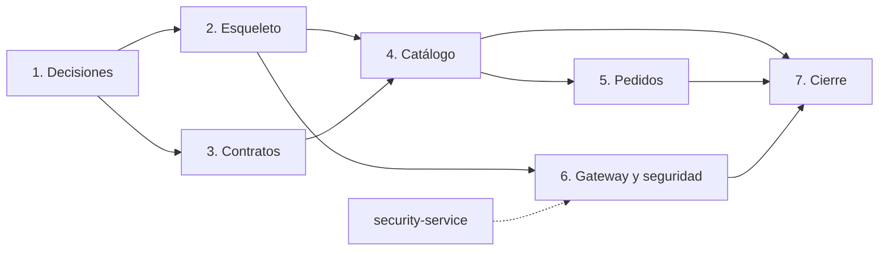

# Backend — ruta de desarrollo (roadmap)

> Documento de trabajo. **No autoriza código de aplicación por sí solo**: la autorización se registra cuando el líder del proyecto la dé.
> Las decisiones, alternativas y riesgos están en [`PLAN.md`](PLAN.md); el alcance funcional, en los [casos de uso](use-cases/README.md); la visión general, en el [README raíz](../README.md).

## 1. Propósito

Convertir el backend de fase de planeación a una beta funcional en 3 semanas, con un orden que evite bloqueos y permita probar cada pieza antes de construir la siguiente.

La ruta respeta las restricciones del proyecto:

- Microservicios obligatorios y una base de datos por servicio.
- Solo el gateway es público.
- JWT RS256 emitido por `security-service`.
- Sin pagos reales, DIAN, Kafka, Kubernetes real ni app móvil en esta fase.

## 2. Estado de partida (2026-11-10)

Hecho:

- Estructura de `gateway`, `catalog` y `orders`.
- Workspace npm con dependencias base instaladas.
- Fastify 5, Prisma 7, Zod, `jose` y Vitest disponibles.
- Documentación del backend y de cada servicio.
- ADR-0001, ADR-0002, ADR-0007 y ADR-0008 aceptados; `gateway.openapi.yaml` en borrador.
- Esqueleto técnico: los tres servicios compilan, arrancan y responden `/health`.
- Dockerfile parametrizado, Docker Compose y `.env.example`.

Pendiente:

- Cuatro ADR bloqueantes: 0003, 0004, 0005 y 0006.
- Contratos por servicio, esquemas Prisma y CI.

## 3. Ruta por etapas

| # | Etapa | Objetivo | Depende de | Estado |
|---|---|---|---|---|
| 0 | Base | Workspace, dependencias y documentación | — | Hecho |
| 1 | Decisiones | Cerrar los ADR que bloquean el código | 0 | En progreso |
| 2 | Esqueleto | *Walking skeleton*: servicios que arrancan y responden `/health` | 1 | Hecho |
| 3 | Contratos | OpenAPI de los casos `Must` de catálogo y pedidos | 1 | Pendiente |
| 4 | Catálogo | `catalog_db`, endpoints públicos y de administración | 2 y 3 | Pendiente |
| 5 | Pedidos | `orders_db`, carrito, direcciones, checkout y pedidos | 4 | Pendiente |
| 6 | Gateway y seguridad | Proxy, validación JWT, roles y controles de entrada | 2 y `security-service` | En progreso |
| 7 | Cierre | Endurecimiento, pruebas de flujo, documentación y demo | 4, 5 y 6 | Pendiente |

**Ruta crítica:** 1 → 2 → 4 → 5 → 6 → 7.
La etapa 3 corre en paralelo con la 2 y la 4.

## 4. Detalle por etapa

### Etapa 1 — Decisiones

Cerrar lo que hoy impide escribir código:

| ADR | Qué se decide | Bloquea | Estado |
|---|---|---|---|
| [ADR-0008](adr/0008-modulos-typescript.md) | ESM nativo, project references y paquete compartido | Arranque y compilación de los tres servicios | Aceptado |
| [ADR-0006](adr/0006-errores-paginacion-idempotencia.md) | Envelope de errores, paginación e idempotencia | Contratos y manejo de errores | Pendiente |
| [ADR-0004](adr/0004-propiedad-datos.md) | Propiedad de datos y contrato backend–BD | Esquemas Prisma y `data-contracts.md` | Pendiente |
| [ADR-0005](adr/0005-comunicacion-interna.md) | `orders` → `catalog` por red interna | Revalidación de precio y stock | Pendiente |
| [ADR-0003](adr/0003-jwt-rs256.md) | Entrega de la clave pública JWT | Autenticación real y despliegue | Pendiente |

**Puerta de salida:** ADR aceptados y `docs/data-contracts.md` redactado.

### Etapa 2 — Esqueleto técnico

- `"type": "module"` y un `tsconfig.json` por paquete que extienda `tsconfig.base.json`.
- Paquete `@perfumespayday/shared` con configuración, errores, `/health`, `requestId`, Helmet y ciclo de vida.
- Estructura mínima por servicio: `src/config/env.ts` y `src/server.ts`.
- `GET /health` en gateway y en cada servicio.
- Manejador de errores uniforme y `requestId` (según ADR-0006).
- Vitest con alias al fuente del paquete compartido y pruebas de humo.
- `.env.example`, un Dockerfile parametrizado por `SERVICE` y `docker-compose.yml`.
- Scripts `dev`, `build`, `start` y `test` en cada `package.json`.

**Puerta de salida:** `docker compose up` levanta el entorno y `GET /health` responde `200`. **Cumplida.**

> Esta etapa y las siguientes requieren autorización explícita del líder del proyecto.

### Etapa 3 — Contratos OpenAPI

- `catalog.openapi.yaml`: productos, marcas, categorías, presentaciones, stock y rutas de administración.
- `orders.openapi.yaml`: carrito, direcciones, checkout, pedidos y auditoría.
- Validar los archivos con una herramienta OpenAPI (por ejemplo, Redocly CLI).

**Puerta de salida:** contratos revisados por frontend, backend y seguridad; ningún endpoint se implementa sin contrato.

### Etapa 4 — Catálogo

- Esquema Prisma de `catalog_db`: marcas, categorías, productos, presentaciones, precios y stock.
- Migraciones y *seeds* con 25 a 30 productos simulados.
- Endpoints públicos: catálogo paginado, búsqueda, filtros y detalle.
- Endpoints de administración: productos, marcas, categorías y stock.
- Endpoint interno de revalidación de precio y stock para `orders`.
- Pruebas de contrato y de integración.

**Casos de uso:** CU-07 a CU-09, CU-20 y CU-25.

**Puerta de salida:** catálogo consultable con datos de demostración y pruebas en verde.

### Etapa 5 — Pedidos

- Esquema Prisma de `orders_db`: carrito, ítems, direcciones, pedidos, ítems de pedido con *snapshot*, historial de estado, auditoría e idempotencia.
- Carrito autenticado y fusión del carrito de invitado (ADR-0007).
- Direcciones de envío.
- Checkout idempotente con revalidación de precio y stock contra `catalog`.
- Historial y detalle de pedidos.
- Administración de pedidos y auditoría.
- Pruebas de flujo.

**Casos de uso:** CU-11 a CU-19 y CU-21 a CU-23.

**Puerta de salida:** checkout simulado completo, sin pagos reales, con pruebas en verde.

### Etapa 6 — Gateway y seguridad

- Proxy de `/api/v1/*` hacia los servicios internos.
- Validación de JWT RS256 con `jose` y verificación de roles.
- CORS con lista de orígenes permitidos, Helmet, rate limit y `requestId`.
- Agregación de auditoría de `catalog` y `orders` (CU-23).
- Integración con los tokens emitidos por `security-service`.

**Puerta de salida:** un usuario autenticado completa el flujo de punta a punta a través del gateway.

### Etapa 7 — Cierre

- Endurecimiento: límites, cabeceras, secretos y exposición de servicios.
- Pruebas E2E de los flujos principales.
- Documentación actualizada por componente y ADR de lo que cambió.
- Guion de demo y criterios de beta verificados.

**Puerta de salida:** checklist de beta del [README raíz](../README.md) §11 completo.

## 5. Ruta crítica y paralelización

- La etapa 3 no bloquea el arranque: puede trabajarse mientras se monta el esqueleto.
- La etapa 6 depende de que `security-service` emita tokens; hasta entonces se acuerda una clave de prueba.
- La etapa 5 no empieza sin catálogo porque el checkout revalida precio y stock.

## 6. Correspondencia con `PLAN.md`

| Etapa de esta ruta | Fase de [`PLAN.md`](PLAN.md) |
|---|---|
| 0. Base | F0 |
| 1. Decisiones y 3. Contratos | F1 |
| 2. Esqueleto | F2 |
| 4. Catálogo | F3 |
| 5. Pedidos | F4 |
| 6. Gateway y seguridad | F5 |
| 7. Cierre | F6 |

## 7. Riesgos de la ruta

| Riesgo | Impacto | Mitigación |
|---|---|---|
| ADR-0004 sin aprobar | No se pueden diseñar los esquemas Prisma | Cerrarlo en la etapa 1 |
| `security-service` atrasado | Bloquea la etapa 6 | Acordar una clave/JWKS de prueba |
| CI sin empezar | Retrasa la integración | Configurarla antes de la etapa 4 |
| Alcance de 3 semanas | Se sacrifican casos `Should` | Priorizar solo los `Must` de la beta |
| Dependencias hoisteadeas por npm workspaces | Fallos difíciles de rastrear | Verificar con `npm ls` al agregar paquetes |

## 8. Próximo paso

La opción 1 quedó implementada: ADR-0008 aceptado y *walking skeleton* funcionando.

El siguiente paso es cerrar **ADR-0006** y **ADR-0004** y escribir los contratos OpenAPI de catálogo y pedidos (etapa 3). Después se implementa el catálogo (etapa 4).

## 9. Registro de avance

| Fecha | Etapa | Estado | Nota |
|---|---|---|---|
| 2026-11-10 | 0. Base | Hecho | Workspace y documentación listos |
| 2026-11-10 | 1. Decisiones | En progreso | ADR-0008 aceptado; faltan 0003, 0004, 0005 y 0006 |
| 2026-11-10 | 2. Esqueleto | Hecho | Build, 7 pruebas y contenedor verificados |
| 2026-11-13 | 6. Gateway y seguridad | En progreso | Validación JWT, guards, proxy `/api/v1`, CORS, rate limit, JWKS y orígenes explícitos; 47 pruebas en verde |

---

**Última actualización:** 2026-11-13
