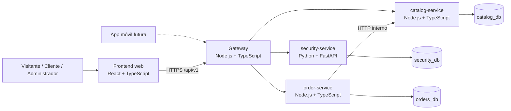

# Arquitectura del sistema

Documento de diseño de **PerfumesPAYDAY**. Explica cómo se compone el sistema, qué responsabilidad tiene cada servicio, quién es dueño de cada dato y cómo se comunican las piezas.

> **Alcance:** beta académica de 3 semanas y 4 personas. No hay código de aplicación ni base de datos creada. Este documento describe el diseño acordado y las decisiones aún abiertas; no reemplaza los [casos de uso](use-cases/README.md) ni los [contratos OpenAPI](api/README.md).

---

## 1. Principios

- **API-first:** toda la lógica se consume por API; la web y el futuro móvil usan los mismos contratos.
- **Microservicios:** cada servicio tiene una responsabilidad concreta y se despliega por separado.
- **Una base de datos por servicio:** no hay tablas ni joins compartidos.
- **Solo el gateway es público:** los servicios internos y PostgreSQL no se exponen a internet.
- **Contratos versionados:** las rutas usan el prefijo `/api/v1`.
- **Seguridad en el servidor:** el rol y el `user_id` salen del token, nunca del cuerpo ni de la URL.
- **Snapshots en pedidos:** el pedido conserva una copia inmutable de productos, precios y dirección.
- **Simplicidad:** sin Kafka, service mesh, event sourcing ni Kubernetes real en esta fase.
- **Docker desde el inicio:** cada servicio tendrá su propio Dockerfile.

---

## 2. Contexto del sistema

**Diagrama:** [`diagrams/01-contexto-sistema.svg`](diagrams/01-contexto-sistema.svg)

### Actores

| Actor | Descripción |
|---|---|
| **Visitante** | Persona sin sesión que explora el catálogo. |
| **Cliente** | Usuario registrado con rol `customer`. |
| **Administrador** | Usuario con rol `admin` que gestiona catálogo y pedidos. |
| **Sistema** | Servicios internos que validan, registran auditoría y ejecutan tareas automáticas. |

---

## 3. Contenedores

**Diagrama:** [`diagrams/02-arquitectura-contenedores.svg`](diagrams/02-arquitectura-contenedores.svg)

| Contenedor | Tecnología | Responsabilidad | Expuesto |
|---|---|---|---|
| **Frontend web** | React + Vite + TypeScript + Tailwind CSS | Interfaz de la tienda, panel administrativo y consumo de la API | Público |
| **App móvil futura** | Por definir | Consumir la misma API en una fase posterior | Fuera de la beta |
| **Gateway** | Node.js 22 + Fastify 5 + TypeScript | Punto único de entrada, enrutamiento `/api/v1`, validación de JWT, CORS, rate limit y agregación de auditoría | Público |
| **security-service** | Python + FastAPI + Pydantic | Registro, login, refresh, logout, perfil, roles y emisión de tokens | Interno |
| **catalog-service** | Node.js 22 + Fastify 5 + TypeScript | Catálogo, marcas, categorías, presentaciones, precios, stock y auditoría de catálogo | Interno |
| **order-service** | Node.js 22 + Fastify 5 + TypeScript | Carrito, direcciones, checkout, pedidos, historial y auditoría de pedidos | Interno |
| **PostgreSQL** | PostgreSQL | Una base de datos por servicio | Interno |
| **Docker** | Docker + Docker Compose | Empaquetado y ejecución local | N/A |

### Responsabilidades detalladas

#### Gateway

- Recibir todo el tráfico público por HTTPS.
- Enrutar `/api/v1/*` al servicio correspondiente.
- Validar el access token JWT (RS256) y el rol cuando aplique.
- Aplicar CORS con lista de orígenes permitidos, Helmet y rate limit.
- Propagar un identificador de petición para trazabilidad.
- Agregar en paralelo los eventos de auditoría de `catalog` y `orders` (CU-23).
- No posee base de datos ni lógica de negocio propia.

#### security-service

- Registrar usuarios con rol `customer`.
- Autenticar y emitir access token + refresh token.
- Rotar el refresh token y revocar sesiones.
- Gestionar el perfil propio y el cambio de contraseña.
- Ser el único servicio que conoce las credenciales y los hashes.
- No gestiona catálogo, carrito, direcciones ni pedidos.

#### catalog-service

- Gestionar productos, presentaciones, marcas y categorías.
- Exponer catálogo público de solo lectura.
- Exponer administración de catálogo y stock.
- Revalidar precio y stock cuando `order-service` lo solicite.
- Descontar stock durante el checkout.
- Registrar auditoría de sus acciones administrativas.

#### order-service

- Gestionar el carrito autenticado.
- Gestionar direcciones de envío.
- Ejecutar el checkout simulado con idempotencia.
- Guardar pedidos con snapshots inmutables.
- Exponer historial y detalle de pedidos.
- Registrar auditoría de sus acciones administrativas.
- Consultar a `catalog-service` para precio y stock; nunca lee `catalog_db`.

---

## 4. Propiedad de datos

| Base de datos | Dueño | Entidades principales | Regla |
|---|---|---|---|
| `security_db` | `security-service` | `users`, `sessions` | Solo `security-service` lee y escribe. |
| `catalog_db` | `catalog-service` | `products`, `product_variants`, `brands`, `categories`, `audit_events` | Solo `catalog-service` lee y escribe. |
| `orders_db` | `order-service` | `carts`, `cart_items`, `addresses`, `orders`, `order_items`, `order_addresses`, `order_status_history`, `audit_events` | Solo `order-service` lee y escribe. |

Reglas:

- **No hay tablas compartidas.** Cada servicio es dueño de su información.
- **No hay joins entre bases de datos.** Si un servicio necesita datos de otro, los pide por API.
- **Los pedidos guardan snapshots** de nombre, presentación, precio y dirección usados en la compra.
- **La auditoría es append-only** y cada servicio es dueño de la suya (CU-23).
- **La base de datos es responsabilidad de otra persona del equipo.** El backend no diseña los esquemas por su cuenta; el contrato se registra en [ADR-0004](adr/0004-propiedad-datos.md) y en `data-contracts.md` (pendiente).

---

## 5. Comunicación

| Origen | Destino | Protocolo | Autenticación | Notas |
|---|---|---|---|---|
| Frontend | Gateway | HTTPS | Bearer JWT / cookie de refresh | Único punto público. |
| Gateway | `security-service` | HTTP interno | Red privada | Proxy de `/api/v1/auth/*` y `/api/v1/users/*`. |
| Gateway | `catalog-service` | HTTP interno | Red privada | Proxy de catálogo y administración. |
| Gateway | `order-service` | HTTP interno | Red privada | Proxy de carrito, direcciones, pedidos y administración. |
| Gateway | `catalog` + `orders` | HTTP interno | Red privada | Consulta paralela de auditoría (CU-23). |
| `order-service` | `catalog-service` | HTTP interno | Por definir (ADR-0005) | Revalidar precio/stock y descontar stock. |
| Servicio | Su base de datos | TCP 5432 | Credenciales por servicio | Sin acceso cruzado. |

### Reglas de comunicación

- El gateway **no** es un bus de negocio: solo enruta, valida y agrega cuando el caso lo exige.
- `order-service` **no** lee `catalog_db`; consulta a `catalog-service`.
- `catalog-service` **no** conoce carritos ni pedidos.
- `security-service` **no** conoce catálogo ni pedidos.
- Las llamadas internas deben tener **timeout**, **reintento controlado** y **manejo de error**; no se reintenta una operación no idempotente sin clave de idempotencia.
- La comunicación interna directa frente al paso por el gateway está pendiente en [ADR-0005](adr/0005-comunicacion-interna.md).

### Contratos

- La API pública usa REST/JSON y el prefijo `/api/v1`.
- Los contratos OpenAPI viven en [`api/`](api/README.md).
- Los errores, la paginación y la idempotencia se definen en [ADR-0006](adr/0006-errores-paginacion-idempotencia.md).
- El formato de error debe ser uniforme en todos los servicios.

---

## 6. Autenticación y autorización

- `security-service` emite **JWT RS256**: access token de corta duración y refresh token de varios días.
- El access token se envía como `Authorization: Bearer <token>`.
- El refresh token viaja en cookie `httpOnly`, `Secure` y `SameSite`.
- El gateway valida la firma y la expiración; cada servicio vuelve a validar el token y el rol (defensa en profundidad).
- El `user_id` y el rol salen del token; nunca del cuerpo ni de la URL.
- El rol `admin` se asigna por fuera de la aplicación y se valida en el servidor.
- La entrega de la clave pública a gateway y servicios está pendiente en [ADR-0003](adr/0003-jwt-rs256.md).

**Detalle completo:** [`security.md`](security.md).

---

## 7. Flujos principales

| Flujo | Casos de uso | Diagrama |
|---|---|---|
| Registro, login, refresh y logout | CU-01 a CU-04 | [`03-autenticacion.svg`](diagrams/03-autenticacion.svg) |
| Catálogo, búsqueda y detalle | CU-07 a CU-10 | [`04-catalogo.svg`](diagrams/04-catalogo.svg) |
| Carrito de invitado y autenticado | CU-11 a CU-15 | [`05-carrito-usuario.svg`](diagrams/05-carrito-usuario.svg) |
| Direcciones y checkout | CU-16 y CU-17 | [`06-direcciones-checkout.svg`](diagrams/06-direcciones-checkout.svg) |
| Historial y detalle de pedidos | CU-18 y CU-19 | [`07-historial-pedidos.svg`](diagrams/07-historial-pedidos.svg) |
| Administración y auditoría | CU-20 a CU-25 | [`08-administracion.svg`](diagrams/08-administracion.svg) |

---

## 8. Despliegue y entornos

| Entorno | Uso | Estado |
|---|---|---|
| Local | Docker Compose con frontend, gateway, servicios y PostgreSQL | Pendiente de implementación |
| Producción / demo | Proveedor por definir, HTTPS y variables de entorno | Pendiente |

Reglas:

- Cada servicio tiene su propio Dockerfile.
- `docker-compose` levanta el entorno local completo.
- PostgreSQL y los servicios internos no se publican a internet.
- Los secretos viven en variables de entorno o archivos montados; nunca en el repositorio.
- Solo se versiona `.env.example`.
- Cada servicio expone un healthcheck interno; el gateway expone `/health`.
- El despliegue y la integración continua se detallan en `deployment.md` (pendiente).

---

## 9. Requisitos no funcionales

| Categoría | Objetivo para la beta | Notas |
|---|---|---|
| **Alcance** | 25 a 30 productos simulados, 3 presentaciones por producto | Datos de demostración. |
| **Rendimiento** | Respuestas interactivas; paginación obligatoria en listados | Sin SLA formal por ser proyecto académico. |
| **Disponibilidad** | Mejor esfuerzo; `503` claro si falla una dependencia | No hay alta disponibilidad. |
| **Seguridad** | Controles de [`security.md`](security.md) aplicados | Pruebas de hacking ético del profesor. |
| **Escalabilidad** | Servicios sin estado; rate limit en memoria para una instancia | Almacén externo (Redis) solo si se escala. |
| **Mantenibilidad** | TypeScript estricto, Zod/Pydantic, pruebas y contratos | Una responsabilidad por servicio. |
| **Observabilidad** | Logs JSON con `requestId`, sin datos personales | Trazabilidad entre gateway y servicios. |
| **Accesibilidad** | Interfaz responsive, HTML semántico, teclado y contraste | Responsabilidad del frontend. |
| **Portabilidad** | Docker y Docker Compose | Mismo entorno para todo el equipo. |
| **Datos** | UUID, ISO 8601 UTC, COP | Convenciones del README raíz. |

---

## 10. Riesgos y decisiones abiertas

| Riesgo | Impacto | Mitigación |
|---|---|---|
| Contrato backend–BD sin definir | Bloquea catálogo y pedidos | [ADR-0004](adr/0004-propiedad-datos.md) y `data-contracts.md`. |
| Entrega de la clave pública JWT | Bloquea autenticación real | [ADR-0003](adr/0003-jwt-rs256.md). |
| Comunicación interna `orders` → `catalog` | Afecta latencia, red y seguridad | [ADR-0005](adr/0005-comunicacion-interna.md). |
| Formato de errores y paginación | Afecta todos los contratos | [ADR-0006](adr/0006-errores-paginacion-idempotencia.md). |
| Estrategia de módulos TypeScript | Bloquea el arranque de los servicios | [ADR-0008](adr/0008-modulos-typescript.md). |
| Tiempo de la beta | Recorta alcance | Priorizar los 18 casos `Must`. |
| Dependencias de base de datos | Pueden quedar sin uso | Confirmar ADR-0004 antes de programar. |

---

## 11. Referencias

- [README raíz](../README.md)
- [Casos de uso](use-cases/README.md)
- [Diagramas](diagrams/README.md)
- [Seguridad](security.md)
- [ADR](adr/README.md)
- [API](api/README.md)
- [Plan del backend](../Backend/docs/PLAN.md)

---

**Última actualización:** 2026-11-10
**Estado:** redactado; sujeto a las decisiones abiertas de los ADR.
